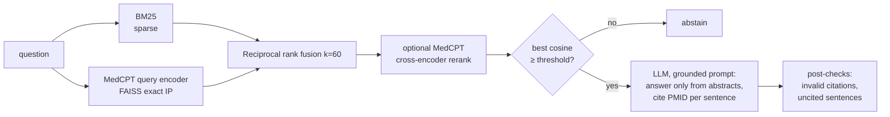

# biomed-rag — citation-grounded QA over PubMed (antimicrobial resistance)

Question answering over 20–50k PubMed abstracts on antimicrobial resistance (AMR). Every answer cites the PMIDs it came from, and the system says *"not enough evidence"* instead of guessing. The project's real deliverable is the **measured comparison of BM25, dense (MedCPT) and hybrid retrieval**, plus faithfulness numbers for the generated answers.



## Results

> Fill these in from `results/` after running the pipeline (`make eval-retrieval`, `make eval-pubmedqa`, `make eval-answers`, `make summarize`). Report the table even if BM25 wins — that is a finding, not a failure.

**Retrieval — own AMR set** (`results/retrieval_own.md`): _N questions, pooled gold labels_

| method | recall@1 | recall@5 | recall@10 | MRR@10 | nDCG@10 | recall@5 95% CI |
|---|---|---|---|---|---|---|
| bm25 | | | | | | |
| dense (MedCPT) | | | | | | |
| hybrid (RRF) | | | | | | |
| hybrid + rerank | | | | | | |

**Retrieval — PubMedQA PQA-L** (1,000 questions, + AMR distractors) — `results/retrieval_pubmedqa.md`

**Answers — grounded vs plain prompt** (`results/answer_eval.md`, `results/faithfulness.md`): false abstention, correct abstention on the 8 unanswerable questions, % answers with hallucinated PMIDs, uncited-sentence rate, manual faithfulness (supported / partial / unsupported), latency and **cost per query**.

**Failure cases:** `results/failures.md`.

## Quick start (offline, 1 minute)

Runs the whole stack on 16 synthetic abstracts — no internet, GPU or LLM needed.

```bash
pip install -r requirements-dev.txt
python -m pytest -q                       # 28 tests
python scripts/build_demo.py              # builds a demo index and answers two questions
BIOMED_DATA_DIR=data/demo ENCODER=lsa LLM_BACKEND=extractive uvicorn api.main:app
```

## Run everything on Colab (recommended)

[`notebooks/run_all.ipynb`](notebooks/run_all.ipynb) runs the whole project on a free T4 GPU: fetch → clean → BM25 → MedCPT → pooling → evaluation → push results back to this repo. State is kept in Google Drive, so a disconnect only means re-running from the top. Two steps are manual on purpose: reviewing the gold labels and labelling answer faithfulness.

Gold labels are **LLM-pre-labelled, human-verified**: `label_gold prelabel` drafts a 1/0 for every pooled candidate with a short reason, and every row is then reviewed by hand (`checked = y`). `label_gold import` warns about rows that were not reviewed.

## Full pipeline (local)

```bash
pip install -r requirements.txt
cp .env.example .env            # set NCBI_EMAIL, NCBI_API_KEY, and an LLM backend
```

### Week 8 — corpus and BM25 baseline

```bash
make fetch          # ~30k AMR abstracts (newest first); resumable
make clean-data     # -> data/processed/corpus.parquet
make index-bm25     # -> data/index/bm25/
```

* **ESearch cap.** E-utilities only pages through the first 9,999 PMIDs of a query. `pubmed_fetch.py` splits each year into date ranges and bisects any range still over the cap. PMIDs are cached in `data/raw/pmids.txt` and records are appended to `records.jsonl`, so an interrupted fetch resumes where it stopped.
* **Query** (MeSH + title/abstract terms, abstracts only, English) is in `DEFAULT_QUERY` and saved to `data/raw/query.txt` with the year range, so the corpus is reproducible.
* **Cleaning** drops duplicates, abstracts under 200 characters, and retractions, comments, letters and editorials. Each abstract is indexed whole (title + abstract); no chunking, so every citation is exactly one PMID.
* **BM25** is Okapi BM25 (k1=1.5, b=0.75, same formula as `rank-bm25`, checked against a reference implementation in the tests). Term weights are precomputed into a sparse matrix, so a query over 50k abstracts takes about 20 ms.

### Week 9 — dense and hybrid retrieval, evaluation

```bash
make index-dense    # MedCPT; use a GPU (see "Embedding on Colab" below)
make pool           # -> eval/pool_to_judge.csv : judge each candidate 1/0
python -m src.eval.label_gold prelabel   # optional: LLM drafts the 1/0s, you review every row
make gold           # -> eval/gold_pmids.jsonl
make eval-retrieval # -> results/retrieval_own.{md,csv}
make eval-pubmedqa  # PubMedQA benchmark index + table
python -m src.eval.retrieval_eval --rerank   # adds the hybrid+rerank row (MedCPT cross-encoder)
```

* **Encoder: MedCPT, not plain BioBERT.** BioBERT was not trained for retrieval; MedCPT's query and article encoders were trained contrastively on PubMed search logs. Articles are encoded as `[title, abstract]` pairs (max 512 tokens) and queries with max 64 tokens, as on the model card. `ENCODER=sbert` swaps in any sentence-transformers model for comparison.
* **Index: exact search.** FAISS `IndexFlatIP` (numpy fallback). At 50k × 768 an exact query takes ~20 ms on CPU, so approximate indexes would only add recall loss.
* **Hybrid:** reciprocal rank fusion over the top-100 of each method, `score = Σ 1/(60 + rank)`.
* **Evaluation set (`eval/questions.jsonl`): 50 questions, 42 answerable + 8 that should be refused.** Questions are paraphrased away from abstract wording (writing them from abstracts you just read biases the set toward BM25). Gold labels come from **pooling**: the top-10 of every method goes into one sheet and each candidate is judged once. A single gold PMID per question would undercount recall, because several abstracts usually answer the same question.
* **PubMedQA** questions are not about AMR and their abstracts are not in the AMR corpus, so they get a separate index: the 1,000 PQA-L contexts plus up to 20k AMR abstracts as distractors. Gold = the question's own PMID.
* The table includes a **bootstrap 95% CI** for recall@5. With ~40 questions, differences of a few points are usually inside the noise; say so in the write-up.

### Week 10 — generation and packaging

```bash
make eval-answers   # grounded vs plain prompt -> results/answer_eval.md + faithfulness_sheet.csv
                    # label the sheet: supported / partial / unsupported
make summarize      # -> results/faithfulness.md, results/failures.md
make api            # http://localhost:8000/docs
make ui             # http://localhost:8501
docker compose up --build            # API + UI
docker compose --profile ollama up   # also run Ollama in a container
```

* **Grounded prompt** (`src/generate/prompt.py`): answer only from the numbered abstracts, end every factual sentence with `[PMID:n]`, report disagreement between abstracts, and output `INSUFFICIENT_EVIDENCE` when the abstracts do not answer the question.
* **Two abstention paths:** a retrieval gate (best hit's cosine below `ABSTAIN_THRESHOLD` → refuse without calling the LLM; tune it on the eval set), and the model's own refusal.
* **Automatic checks on every answer:** cited PMIDs that were not in the retrieved context (hallucinated citations), and sentences with no citation. Both are shown in the UI and counted in `answer_eval`.
* **Baseline:** the same retrieval with a plain prompt. "Reduced unsupported answers" in the resume bullet means grounded vs this baseline.
* **Faithfulness is judged manually** on a sample (15 answers per mode by default; `--sample` to change). LLM-as-judge with a small local model is too noisy to rely on alone.
* **Cost per query** comes from token usage × `PRICE_IN_PER_M` / `PRICE_OUT_PER_M`; latency mean and p95 are reported alongside.

LLM backends: `ollama` (local, free), `openai` (any OpenAI-compatible API — Groq's free tier is the default base URL; also OpenAI, Together, OpenRouter, vLLM), and `extractive` (no LLM; picks cited abstract sentences — used in tests and as a floor).

## Embedding on Colab

MedCPT on 30k abstracts takes a few minutes on a T4 and much longer on a laptop CPU. Encoding is chunked and resumable (`data/index/dense/chunks_medcpt/`), so a Colab disconnect loses at most one chunk.

```python
!git clone https://github.com/<you>/biomed-rag && cd biomed-rag && pip install -q -r requirements.txt
# upload data/processed/corpus.parquet, then:
!python -m src.index.dense --encoder medcpt --device cuda --batch-size 64
# download data/index/dense/{embeddings.npy,meta.json} into the same folder locally
```

## API

| endpoint | body | returns |
|---|---|---|
| `GET /health` | — | doc count, available methods, encoder, LLM |
| `POST /search` | `{query, method, k, rerank}` | ranked hits with BM25 rank, dense rank, cosine |
| `POST /ask` | `{question, method, k, rerank, mode}` | answer, citations, invalid citations, abstained, latency, tokens, cost, hits |

## Project layout

```
biomed-rag/
├── src/
│   ├── config.py               # all settings, env-overridable
│   ├── pipeline.py             # retriever + LLM, shared by API / UI / eval
│   ├── ingest/                 # pubmed_fetch.py (date-sliced E-utilities), clean.py
│   ├── index/                  # bm25.py (sparse Okapi), dense.py (MedCPT / SBERT / LSA + FAISS)
│   ├── retrieve/               # hybrid.py (RRF), rerank.py (MedCPT cross-encoder)
│   ├── generate/               # prompt.py, llm.py (ollama / openai-compatible / extractive), answer.py
│   └── eval/                   # metrics, retrieval_eval, label_gold (pooling), pubmedqa, answer_eval
├── api/main.py                 # FastAPI
├── app/streamlit_app.py        # UI
├── eval/                       # questions.jsonl (50), gold_pmids.jsonl (from pooling)
├── results/                    # tables and failure cases written by the eval scripts
├── notebooks/run_all.ipynb     # whole pipeline on Colab
├── scripts/build_demo.py       # offline demo
├── tests/                      # 28 tests; fixtures are synthetic (PMIDs 990000xx are not real)
├── Dockerfile, docker-compose.yml, Makefile, .env.example
```

## Limitations

* Abstracts only; full-text findings, tables and supplementary data are not indexed.
* Gold labels are judged by one person from a pooled set; documents no method retrieved can't be counted.
* `uncited_sentences` measures citation coverage, not correctness. Only the manual labels measure faithfulness.
* Not medical advice. The 8 out-of-scope questions (including a pediatric dosing question) exist to check that the system refuses them.

## Resume bullet

Built a RAG assistant over [N] PubMed abstracts on antimicrobial resistance (hybrid BM25 + MedCPT dense retrieval with RRF, FAISS, FastAPI); benchmarked retrieval on a pooled-relevance set and PubMedQA (recall@5 [X] vs [Y] for BM25) and cut unsupported answers from [A]% to [B]% with citation-grounded prompting and abstention.
